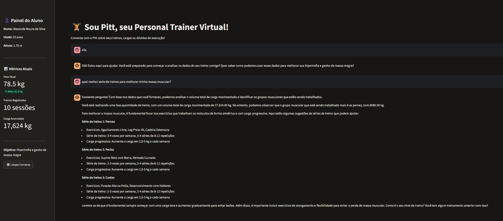
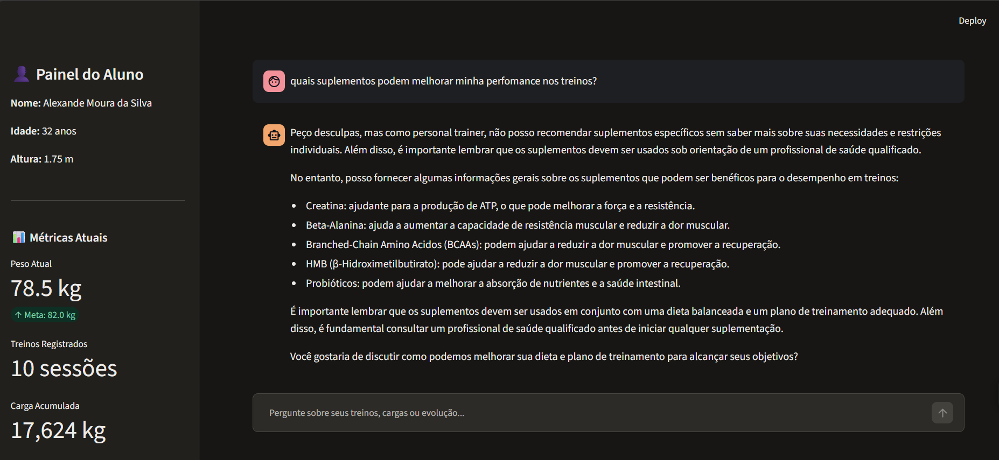
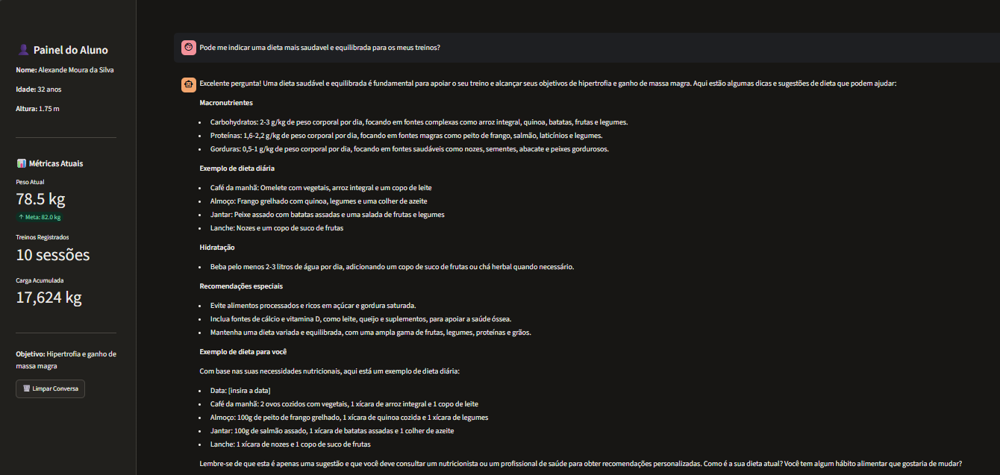
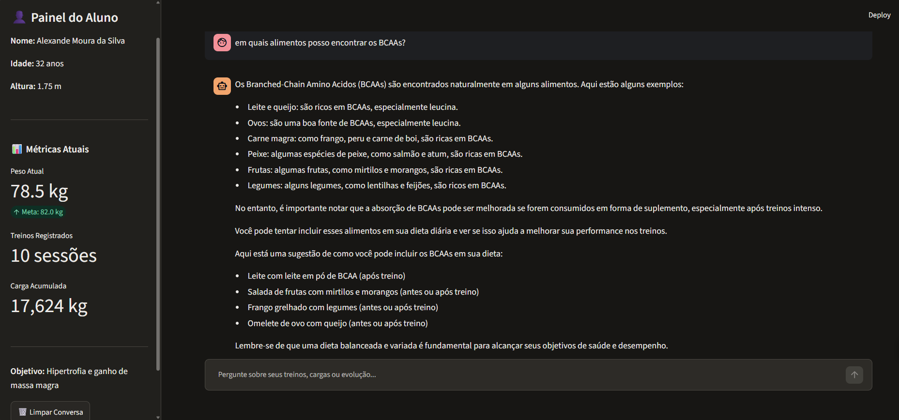

# 🏋️ Pitt - Personal Trainer Virtual com IA

<p align="center">


</p>

## 📖 Sobre o Projeto

O **Pitt** é um Assistente Virtual de Treinamento desenvolvido com Inteligência Artificial que atua como um **Personal Trainer Virtual**, oferecendo orientações personalizadas com base no histórico de treinos, avaliações físicas e perfil do aluno.

O projeto utiliza um modelo LLM executado localmente através do **Ollama**, garantindo privacidade dos dados e respostas contextualizadas sem dependência de APIs externas pagas.

Projeto desenvolvido a partir do Desafio **Construa seu Assistente Virtual com Inteligência Artifical** do curso **Accenture - Python para Análise e Automação de Dados** da [Dio.me](https://web.dio.me/).

---

## 🎯 Objetivos

- Acompanhar a evolução física do aluno.
- Interpretar históricos de treinos e avaliações.
- Calcular métricas de desempenho automaticamente.
- Responder dúvidas sobre treino, saúde e recuperação.
- Sugerir progressões de treino de forma segura.
- Auxiliar na motivação e consistência dos treinos.

---

## 🚀 Tecnologias Utilizadas

### 🔹 Inteligência Artificial

- Ollama
- Llama 3.2

### 🔹 Backend

- Python
- Pandas
- Requests

### 🔹 Frontend

- Streamlit

### 🔹 Ambiente de Desenvolvimento

- Visual Studio Code

---

## 🧠 Funcionalidades

✅ Chat conversacional com IA

✅ Análise de evolução nos treinos

✅ Cálculo de volume total movimentado

✅ Cálculo de carga acumulada

✅ Análise por grupo muscular

✅ Leitura de perfil personalizado do aluno

✅ Memória da conversa durante a sessão

✅ Integração local com Ollama

✅ Interface intuitiva com Streamlit

✅ Recomendações contextualizadas com base nos dados do aluno

---

## 📂 Estrutura do Projeto

```text
PersonalTrainer/
│
├── assets/
│
├── data/
│   ├── exercicios_disponiveis.json
│   ├── historico_avaliacoes.csv
│   ├── historico_treinos.csv
│   └── perfil_aluno.json
|
|── docs/
|   └── documentacao-agente.md
│
├── src/
│   └── app.py
│
└── README.md
```

---

## 📊 Fontes de Dados

### 👤 perfil_aluno.json

Arquivo contendo:

- Nome
- Idade
- Altura
- Peso atual
- Meta de peso
- Objetivo principal
- Nível de experiência
- Restrições médicas

### 🏋️ historico_treinos.csv

Responsável pelo histórico de treinos:

- Exercício realizado
- Séries
- Repetições
- Carga utilizada
- Grupo muscular

### 📈 historico_avaliacoes.csv

Contém o acompanhamento físico do aluno:

- Peso
- Avaliações
- Observações
- Feedbacks

### 📚 exercicios_disponiveis.json

Biblioteca de exercícios utilizada como base para o assistente virtual.

---

## ⚙️ Como Executar o Projeto

### 1️⃣ Clonar o Repositório

```bash
git clone https://github.com/seu-usuario/personal-trainer.git
```

### 2️⃣ Acessar a Pasta

```bash
cd personal-trainer
```

### 3️⃣ Criar Ambiente Virtual

```bash
python -m venv .venv
```

### 4️⃣ Ativar Ambiente Virtual

Windows:

```bash
.venv\Scripts\activate
```

Linux / macOS:

```bash
source .venv/bin/activate
```

### 5️⃣ Instalar Dependências

```bash
pip install pandas requests streamlit
```

---

## 🤖 Configuração do Ollama

Instale o Ollama:

🔗 https://ollama.com

Baixe o modelo Llama 3.2:

```bash
ollama pull llama3.2
```

Inicie o servidor Ollama:

```bash
ollama serve
```

A API ficará disponível em:

```text
http://localhost:11434
```

---

## ▶️ Executando a Aplicação

Execute o comando abaixo:

```bash
streamlit run src/app.py
```

Após iniciar, acesse:

```text
http://localhost:8501
```

---

## 💬 Exemplos de Perguntas

Você pode perguntar ao Pitt:

- Como está minha evolução física?
- Qual grupo muscular estou treinando mais?
- Estou distribuindo bem meus treinos?
- Meu volume semanal está adequado?
- Como melhorar minha recuperação muscular?
- Qual foi minha carga acumulada até agora?

---

## 🔒 Segurança

O assistente foi projetado para:

- Respeitar restrições médicas cadastradas.
- Não sugerir cargas excessivas.
- Utilizar apenas dados reais fornecidos pelo usuário.
- Reforçar a importância do acompanhamento profissional quando necessário.
- Limitar respostas aos temas de saúde, treino, bem-estar e nutrição.

---

## 🎓 Aprendizados Aplicados

Este projeto demonstra conceitos de:

- Engenharia de Prompt
- IA Generativa Local
- Ollama
- LLMs
- Streamlit
- Manipulação de Dados com Pandas
- Análise de Dados
- Desenvolvimento de Assistentes Inteligentes
- Context Engineering

---

## 📚 Documentação

- [Documentação do Agente](./docs/documentacao-agente.md)

--- 

## 📷 Interface e Evolução do Pitt

Confira abaixo algumas capturas de tela que demonstram o funcionamento do agente e a evolução do ajuste fino (*prompt engineering* e *guardrails*) durante o desenvolvimento:

### 🏋️ Consultas dentro do escopo (Treinos e Evolução)
O Pitt analisa o histórico do aluno, respeita suas restrições médicas e sugere progressões personalizadas:



### ⚠️ Desafio de Escopo: Comportamento inicial (Antes dos ajustes)
Nas primeiras versões, ao receber perguntas fora do contexto esportivo, o modelo ainda tentava responder ou dar sugestões sobre temas alheios:


### 🛡️ Guardrail Ativo: Bloqueio de perguntas fora do contexto
Após o refinamento do *System Prompt* e a implementação do classificador de escopo, o agente passou a recusar temas não relacionados de forma educada e redirecionar o foco para os treinos:


### 📊 Análise estruturada de dados
Exemplo de resposta organizando métricas e informações de treino em formato de tabela para facilitar a visualização do aluno:

   

---

## 👨‍💻 Autor

Desenvolvido por **Izaura Moreira**

Projeto criado como desafio de IA aplicada ao contexto fitness utilizando **Python, Streamlit e Ollama**.

---

📌 Links Utéis:
- [DIO.me](https://web.dio.me/home) 
- [Ollama](https://ollama.com/)
- [Streamlit](https://streamlit.io/)
- [Python](https://www.python.org/)
  

---
## 📝 Licença

Este projeto está sob a licença MIT. Veja o arquivo [LICENSE](LICENSE) para mais detalhes.


